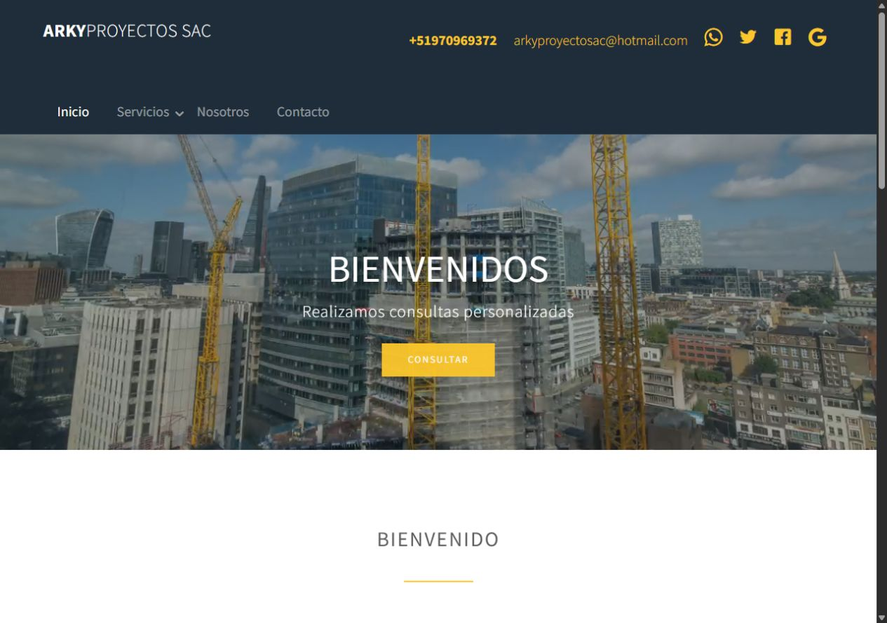
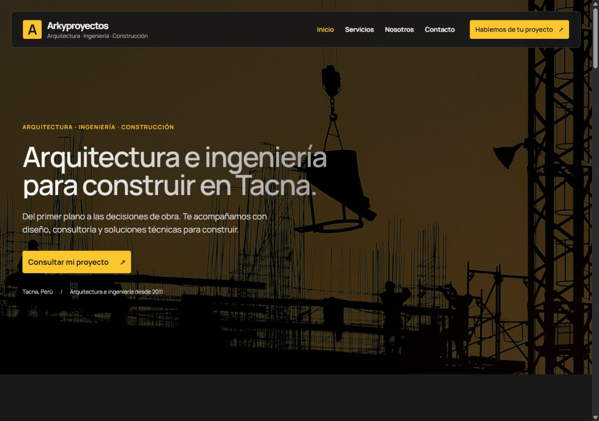
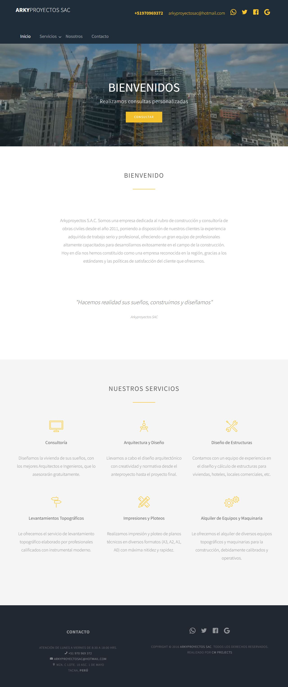
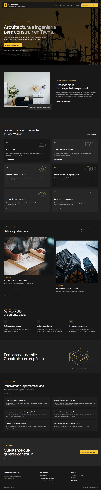
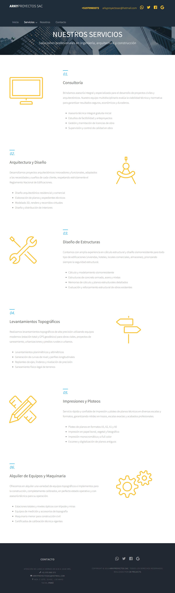
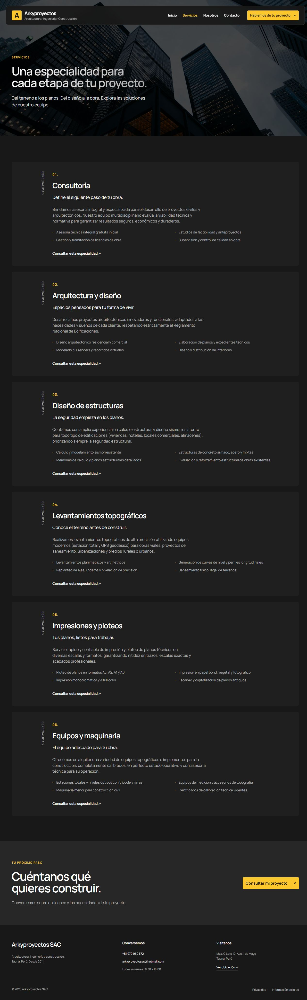
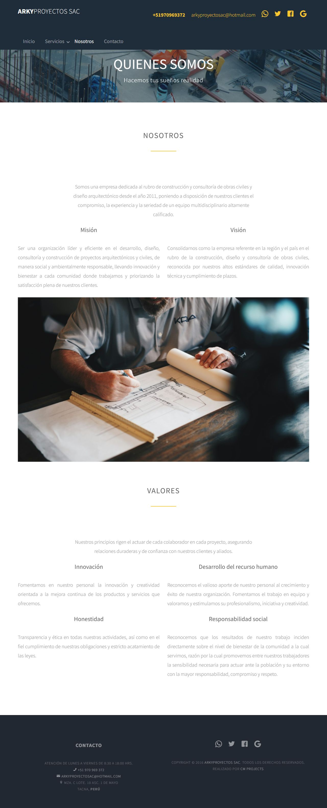
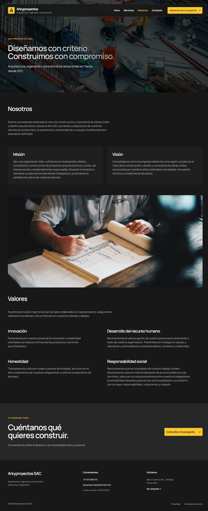
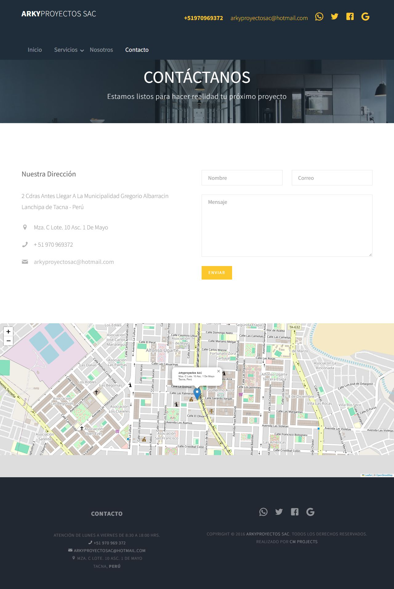
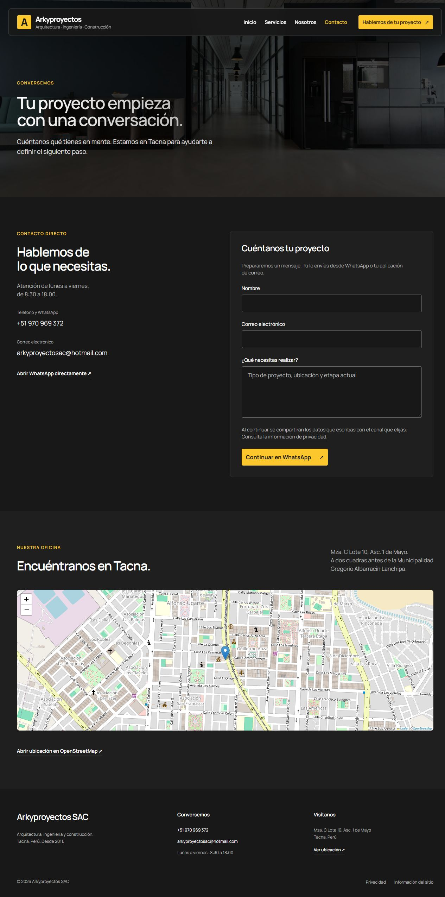

# Arkyproyectos SAC

Sitio corporativo estático de arquitectura, ingeniería, construcción y consultoría en Tacna, Perú.

[Sitio de producción](https://arkiproyectos.cmaquera.com/)

## Comparación visual: antes y después

El sitio mantiene únicamente la versión actual. La versión anterior se muestra aquí mediante capturas, sin añadir una segunda web ni un comparador al sitio.

- **Antes:** estado guardado en el commit `7a952a9`, previo al rediseño.
- **Después:** versión actual con la corrección de columnas, ilustraciones técnicas, referencias visuales y preguntas reorganizadas.
- **Capturas:** navegador con viewport de 1280 × 900 píxeles. Las imágenes completas incluyen todo el recorrido de cada página; sus alturas varían porque cambió la composición.

### Vista rápida de Inicio

| Antes | Después |
| --- | --- |
| [](docs/comparacion/index-antes.jpg) | [](docs/comparacion/index-despues.jpg) |

### Páginas completas

Despliega cada página para comparar ambas capturas lado a lado. Pulsa una imagen para verla a tamaño completo.

<details>
<summary>Inicio: antes y después</summary>

| Antes | Después |
| --- | --- |
| [](docs/comparacion/index-antes.jpg) | [](docs/comparacion/index-despues.jpg) |

</details>

<details>
<summary>Servicios: antes y después</summary>

| Antes | Después |
| --- | --- |
| [](docs/comparacion/servicios-antes.jpg) | [](docs/comparacion/servicios-despues.jpg) |

</details>

<details>
<summary>Nosotros: antes y después</summary>

| Antes | Después |
| --- | --- |
| [](docs/comparacion/nosotros-antes.jpg) | [](docs/comparacion/nosotros-despues.jpg) |

</details>

<details>
<summary>Contacto: antes y después</summary>

| Antes | Después |
| --- | --- |
| [](docs/comparacion/contacto-antes.jpg) | [](docs/comparacion/contacto-despues.jpg) |

</details>

## Páginas

- `index.html`: propuesta de valor, seis especialidades, proceso de consulta y preguntas frecuentes.
- `servicios.html`: catálogo técnico con enlaces directos a cada especialidad.
- `nosotros.html`: trayectoria, misión, visión y valores.
- `contacto.html`: formulario asistido por WhatsApp, alternativa de correo y mapa de ubicación.
- `privacidad.html`: funcionamiento del formulario y recursos de terceros.
- `informacion.html`: alcance de la información publicada y canales de contacto.
- `404.html`: página de error con navegación de regreso.

## Desarrollo local

```powershell
python -m http.server 8080 --bind 127.0.0.1
```

Abre `http://127.0.0.1:8080/`. No requiere compilación ni backend.

## Diseño y accesibilidad

- Manrope con pesos 400, 500, 600 y 700; superficies carbón y acento amarillo.
- Estilos compartidos en `css/style.css`; Bootstrap se conserva solo para la rejilla del contenido existente.
- Navegación móvil con botón accesible, aislamiento del contenido, recorrido de foco y cierre con Escape.
- Enlace para saltar al contenido, etiquetas de formulario, errores asociados y estados de foco visibles.
- Animaciones mediante IntersectionObserver, con contenido visible si no se ejecuta JavaScript y adaptación a `prefers-reduced-motion`.
- Portada con imagen estática: evita la descarga automática del video de fondo anterior.
- Favicon SVG, metadatos sociales y enlaces canónicos por página.
- Ilustraciones técnicas SVG en `images/technical`, referencias fotográficas identificadas como ilustrativas y preguntas frecuentes en dos columnas en escritorio.
- Los contenedores que usan Grid o Flex excluyen los elementos de limpieza heredados de Bootstrap para evitar columnas vacías.

`js/main.js` y `js/contact.js` usan JavaScript nativo. Las librerías antiguas permanecen en el repositorio, pero ya no se cargan. Los archivos Sass heredados tampoco generan la hoja de estilos actual.

## Formulario

El formulario valida nombre, correo y mensaje. Al continuar prepara un enlace a WhatsApp con la consulta. El visitante confirma el envío en WhatsApp; la web no confirma la entrega del mensaje.

El resultado incluye enlaces alternativos para abrir WhatsApp o un borrador en la aplicación de correo. Los campos se conservan. Si se modifica la consulta, se descarta el mensaje preparado para evitar enviar una versión anterior.

## Recursos externos

- Google Fonts para Manrope, con alternativa `sans-serif` si no carga.
- Leaflet 1.9.4 desde unpkg, solo en Contacto.
- Teselas de OpenStreetMap, con enlace directo de respaldo si falla el mapa.
- WhatsApp y la aplicación de correo, únicamente al elegir esos canales.

## Publicación

Sube los HTML, `css`, `js`, `images`, `favicon.svg` y `favicon.ico` a un hosting estático. Se incluyen versiones en las URLs de los archivos CSS y JavaScript para renovar cachés.

Configura el hosting para servir `404.html` ante rutas inexistentes y devolver el estado HTTP 404. El servidor de desarrollo de Python no hace esta asociación automáticamente. La página se puede revisar directamente en `/404.html`.

Si cambia el dominio, actualiza los enlaces canónicos y las URLs de Open Graph en los HTML. Los textos de privacidad describen el comportamiento actual; deberán actualizarse si se añaden analítica, almacenamiento o nuevos proveedores.

## Autoría

Realizado por [CMaquera](http://cmaquera.com).
